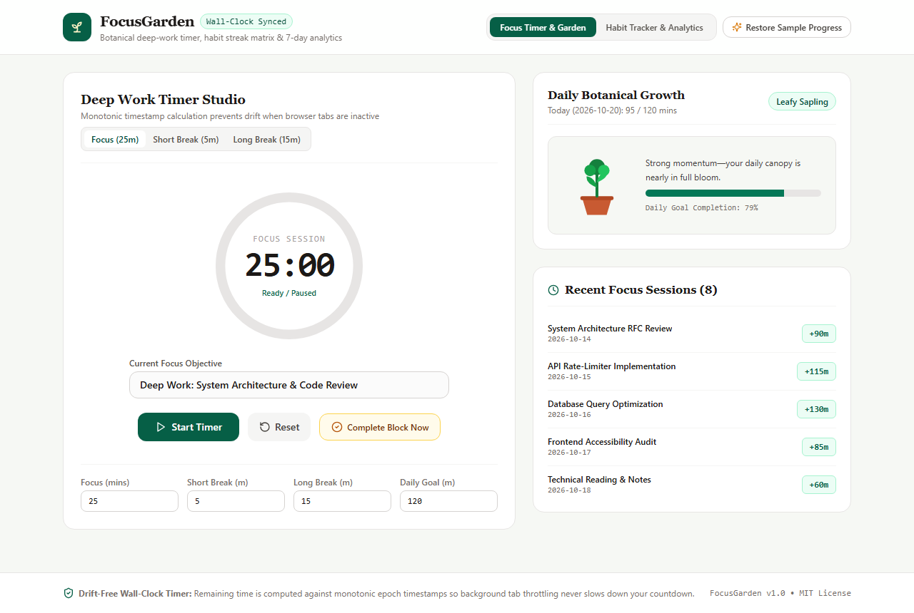
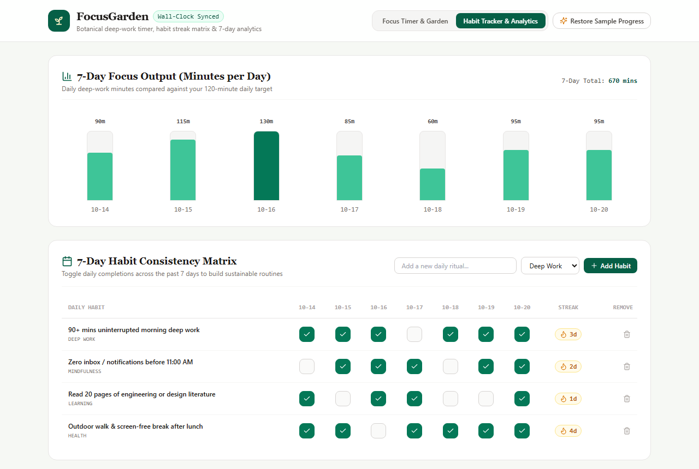
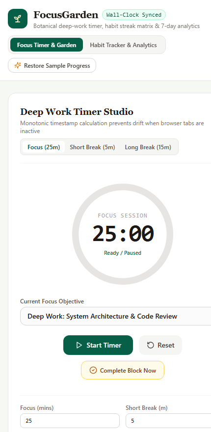

# FocusGarden — Drift-Free Focus Timer & Botanical Habit Sanctuary

[](https://opensource.org/licenses/MIT)
[](https://www.typescriptlang.org/)
[](https://react.dev/)
[](https://github.com/iamnarace/focusgarden/actions/workflows/ci.yml)

**FocusGarden** is a calm, background-resilient focus timer and daily habit tracker that pairs a wall-clock synchronized Pomodoro studio with a dynamic SVG botanical growth companion, 7-day habit consistency matrix, and local session analytics.

---

## Why FocusGarden?

Many web-based Pomodoro timers rely on naive `setInterval(() => seconds--, 1000)` counters. When a user switches to an IDE or another browser tab, modern browsers throttle background timers—causing a 25-minute session to take 35+ minutes or freeze altogether.

**FocusGarden** solves this by anchoring every active countdown to a monotonic wall-clock timestamp (`targetEndTimeMs = Date.now() + remainingSeconds * 1000`) and listening to `document.visibilitychange`, guaranteeing zero drift even when the tab is backgrounded.

---

## Key Features

- **Wall-Clock Synchronized Timer:** Drift-free countdown engine that remains accurate when browser tabs become inactive or throttled.
- **Configurable Intervals & Daily Goals:** Customize Focus, Short Break, Long Break, and Daily Focus Goal durations in minutes.
- **Botanical Growth Companion:** Custom SVG plant illustration that progresses through four stages (*Dormant Seed*, *Sprouting Seedling*, *Leafy Sapling*, and *Flowering Canopy*) as you complete focus minutes toward your daily target.
- **7-Day Habit Consistency Matrix:** Check off daily rituals across a 7-day rolling window with automatic consecutive streak calculation.
- **7-Day Focus Output Bar Chart & Session History:** Inspect daily deep-work minutes and review timestamped focus blocks stored locally in `localStorage`.

---

## Screenshots

### Desktop — Deep Work Timer Studio & Botanical Growth Companion


### Feature View — 7-Day Focus Chart & Habit Consistency Matrix


### Mobile Responsive View
<p align="left">
  
</p>

---

## Technology Stack

- **Framework:** React 18 + TypeScript 5
- **Styling:** Tailwind CSS (Warm Sage, Moss & Terracotta botanical palette)
- **Graphics:** Custom SVG circular progress dial, botanical growth artwork, and 7-day bar chart
- **Icons:** Lucide React
- **Build & Test:** Vite 5, Vitest, React Testing Library, ESLint

---

## Requirements & Installation

- **Node.js:** v18.18+ or v20+
- **npm:** v9+

```bash
# Clone the repository
git clone https://github.com/iamnarace/focusgarden.git
cd focusgarden

# Install dependencies
npm install
```

---

## Local Development, Build & Testing

```bash
# Start local development server
npm run dev

# Run ESLint check
npm run lint

# Run Vitest unit & component tests
npm test

# Build production bundle
npm run build
```

---

## Usage Guide

1. **Start a Focus Session:** Enter your current objective in the **Current Focus Objective** field and click **Start Timer** (or click **Complete Block Now** to log a completed block immediately).
2. **Customize Durations:** Adjust **Focus (mins)**, **Short Break (m)**, **Long Break (m)**, and **Daily Goal (m)** at the bottom of the timer studio.
3. **Track Daily Habits:** Switch to **Habit Tracker & Analytics** to view your 7-day focus bar chart, toggle daily habit completions, or add new habits.
4. **Reset Sample Progress:** Click **Restore Sample Progress** in the header at any time to reload the 7-day demonstration dataset.

---

## Project Structure

```text
focusgarden/
├── .github/
│   ├── ISSUE_TEMPLATE/
│   ├── workflows/ci.yml
│   └── pull_request_template.md
├── docs/
│   └── screenshots/
├── src/
│   ├── test/
│   │   ├── focusEngine.test.tsx
│   │   └── setup.ts
│   ├── utils/
│   │   └── focusEngine.ts
│   ├── App.tsx
│   ├── index.css
│   └── main.tsx
├── CHANGELOG.md
├── CONTRIBUTING.md
├── LICENSE
├── SECURITY.md
├── package.json
└── vite.config.ts
```

---

## Security & Privacy Considerations

- **100% Local Persistence:** All session logs, custom habits, and timer presets are stored in `window.localStorage`. No network requests or external analytics are used.

---

## Known Limitations

- **Browser Profile Storage:** Progress is saved per browser profile. Clearing browser site data resets local history unless backed up.
- **No Background Push Notifications:** If the browser window is completely closed (terminated), the session will resume or complete when the page is reopened rather than triggering OS-level push notifications.

---

## Roadmap

- [ ] Optional Web Audio API gentle chime synthesizer on timer completion
- [ ] JSON backup export and restore for habit history
- [ ] Monthly calendar heatmap view

---

## Contributing

Contributions are welcome! Please read [CONTRIBUTING.md](./CONTRIBUTING.md) before submitting a pull request.

---

## Acknowledgements

Developed with assistance from Google Antigravity.

---

## License

Licensed under the [MIT License](./LICENSE). Copyright (c) 2026 Naresh Adhikari.
